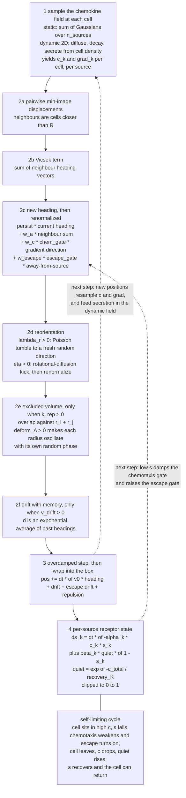
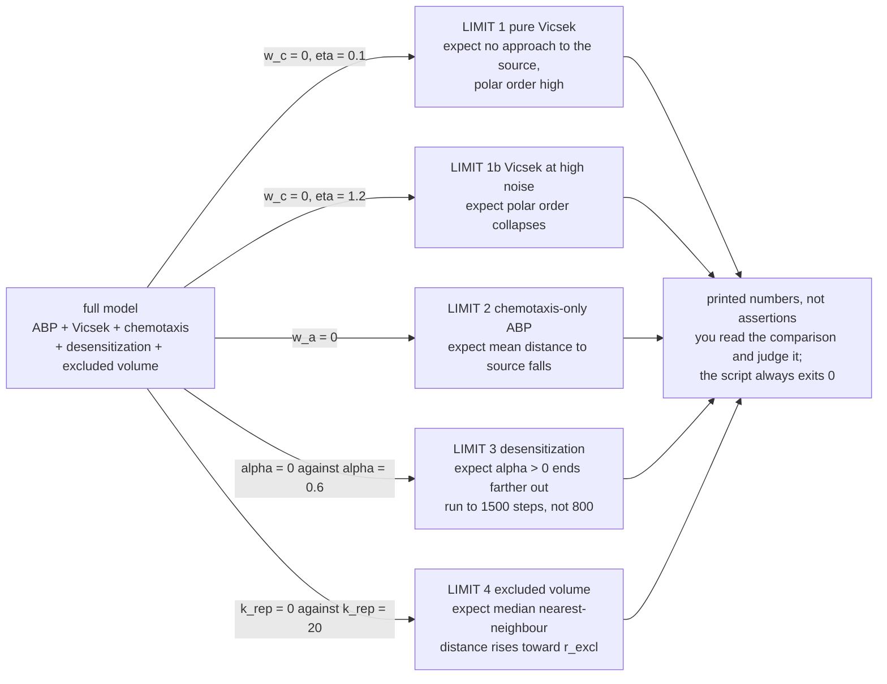

# T-cell Swarming - Active Matter Simulation

2D self-propelled-particle model of why T-cell swarms self-limit in vivo:
ABP + Vicsek alignment + chemotaxis, plus desensitization, excluded volume,
chemokine secretion, and drift-with-memory. See `SKILL.md` for the science.

## One integration step

`simulate()` is a single vectorized loop over `n_steps`. Every ingredient is a
term added into one heading vector or one position update, and each creative
ingredient is inert at its default, so the loop below collapses back to plain
ABP plus Vicsek when nothing is switched on.



`quiet` is what makes the cycle close rather than run away: recovery is gated on
low total chemokine, so adding sources or lowering `recovery_K` removes the
quiet space a cell needs to resensitize, and the oscillation flattens into
exhaustion.

## The limit ladder

`sanity_checks.py` is the acceptance test for the model, not for the code: a new
ingredient is only trusted if switching it off reproduces the simpler model it
was built on top of. Every run uses `seed=2`.



## Setup (one time)

```bash
python3 -m venv .venv
source .venv/bin/activate          # Windows: .venv\Scripts\activate
pip install -r requirements.txt
```

`requirements.txt` is the human-readable spec; `requirements-lock.txt` is the
exact pinned set (`pip freeze`) for byte-for-byte reproducibility.

## Run things

Always `source .venv/bin/activate` first.

| Command | What it does |
|---|---|
| `python simulate.py` | Smoke test: prints output shapes, checks aggregation. |
| `python sanity_checks.py` | The limit-test protocol (turn each ingredient off → recover simpler model). |
| `python visualize.py` | Renders `swarm_snapshots.png` + `aggregation_curve.png` (µm / min units). |
| `python interactive_sim.py` | Live window: parameter sliders → **Run** → drag **Time** to replay. |

The interactive explorer includes one-click demo presets: **Base**, **Ring**,
**Osc**, **Vortex**, **Exhaust**, and **Rescue**. They set the sliders and run
the scene immediately; **Rescue** also uses a larger hidden box size to restore
quiet recovery space.

Chemokine playground knobs now include multiple source sites (`n_sources`),
spacing between those sites (`source_distance`), source amplitude
(`source_1_strength` ... `source_4_strength`; `source_strength` remains a
backward-compatible global fallback), and dynamic field parameters
(`dynamic_chemokine`, `D_chem`, `S_chem`, `lambda_chem`). In the interactive
explorer, toggle **Chem: static/dynamic** and use the chemokine sliders to tune
source count, source spacing, each source's strength, diffusion, cell secretion,
and decay.

Desensitization is source-aware: each cell tracks a separate sensitivity channel
for each active source (`source_sensitivity` in the returned trajectory). The
global `alpha` and `beta` sliders apply to every source, while scripted runs can
override individual channels with `alpha_1` ... `alpha_4` and `beta_1` ...
`beta_4`. Recovery is also quiet-zone gated: total chemokine suppresses recovery
through `recovery_K`, so dense multi-source fields can remove the low-signal
regions needed for cells to refresh. Desensitized cells can actively leave a
source through `w_escape`, a down-gradient escape drive that shuts off again in
quiet space as sensitivity returns.

For the clearest single-source relaxation cycle, start near
`alpha=0.45`, `beta=0.25`, `recovery_K=0.6`, `w_escape=3.0`, and moderate
repulsion (`k_rep=5` to `10`). Raising source count or lowering `recovery_K`
shrinks quiet recovery space and can collapse the oscillation into exhaustion.

## Files

- `simulate.py` - the canonical engine. `simulate(params, seed)` returns the
  hand-off contract dict. `DEFAULTS` is the single source of truth for all
  parameters and the µm / minute unit anchors.
- `sanity_checks.py` - runnable sanity protocol.
- `visualize.py` - static figures.
- `interactive_sim.py` - interactive desktop explorer (needs a GUI backend).

## Analysis & sweep pipeline (Track A additions)

Built on top of the engine; everything consumes the same hand-off dict.

| File | What it does |
|---|---|
| `observables.py` | swarm size, internal polar order, source density, tight-core density, persistence, dispersal-mode classifier |
| `sweep.py` | `(alpha, k_rep)` phase-diagram sweep → `phase_diagram_*.png` heatmaps |
| `animate.py` | `make_movie` (mp4→gif fallback) + `save_snapshots` for slides |
| `io_utils.py` | `save_trajectory` / `load_trajectory` (.npz, params ride along as JSON) |

```python
from simulate import simulate, DEFAULTS
from sweep import run_sweep, plot_phase_diagram
from animate import make_movie
import numpy as np

traj = simulate(dict(DEFAULTS, n_sources=3, source_distance=18.0,
                     source_1_strength=1.4, source_2_strength=0.8,
                     source_3_strength=1.0,
                     dynamic_chemokine=True,
                     D_chem=0.5, S_chem=0.2, lambda_chem=0.03,
                     alpha=0.1, beta=0.03, recovery_K=0.4,
                     w_escape=0.8, k_rep=5.0, v_drift=0.4), seed=0)
make_movie(traj, "swarm.mp4")
grids = run_sweep(np.linspace(0, 0.6, 6), np.linspace(0, 12, 6), n_steps=1200)
plot_phase_diagram(grids, "core_density")
```

**Headline result:** in the `(alpha, k_rep)` sweep, the Keller-Segel pile-up
(`core_density`) survives *only* at low-alpha / low-k_rep - **either** biochemical
desensitization or mechanical repulsion quenches the singular collapse, while
`density_at_source` shows `alpha` setting overall retention at the infection site.
